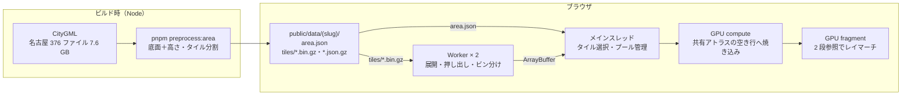
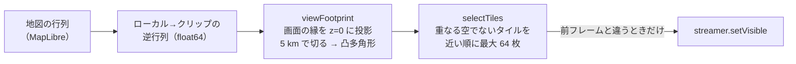
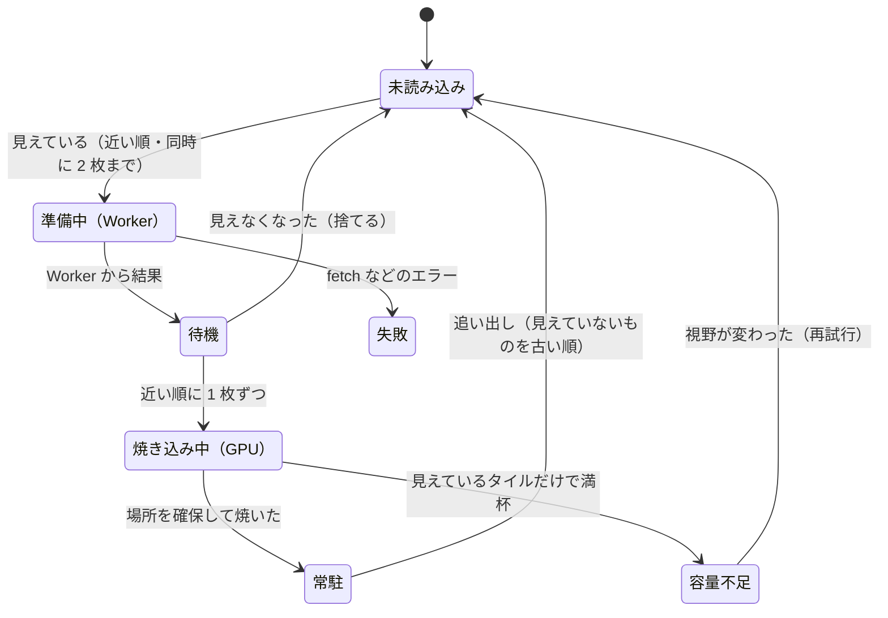
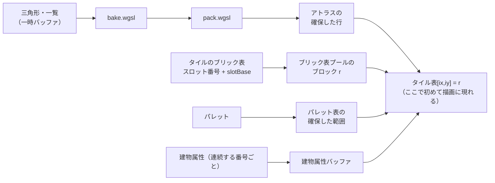
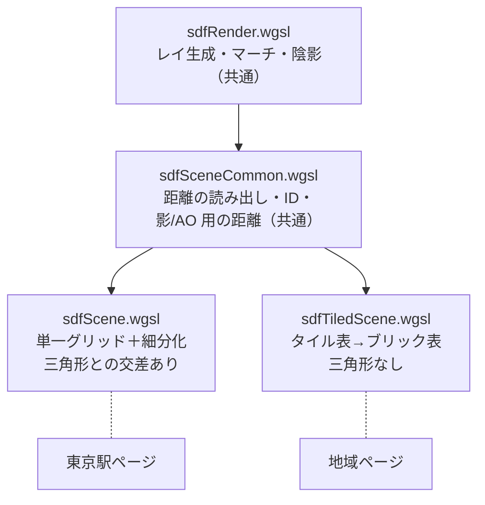
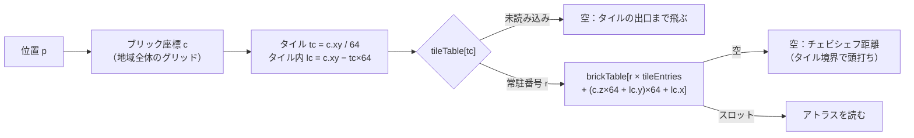

# 地域ページ（`/<slug>/`、LOD1）の仕組み

市区町村全域の建物を LOD1 で表示します。全域を一度に焼くと GPU メモリが足りないため、1024 m 四方のタイルに分け、表示範囲のタイルだけを読み込んで共有の GPU プールに焼き込み、要らなくなったタイルは追い出します。東京駅ページ（LOD2、1 回のベイク）は [lod2-station.md](lod2-station.md) を参照してください。

| 地域 | 建物 | 空でないタイル | 配信データ | 原点・初期表示 |
|---|---|---|---|---|
| 千代田区（`/chiyodaku/`、2025 年度） | 38,743 棟 | 27 | 2.8 MB | 東京駅 |
| 名古屋市（`/nagoya/`、2022 年度） | 738,178 棟 | 384 | 51 MB | 名古屋駅 |

東京駅ページとの主な違い:

| | 東京駅（LOD2） | 地域（LOD1） |
|---|---|---|
| 配信する形 | 三角形のメッシュ 1 ファイル | 底面の多角形＋高さ、タイルごと |
| 三角形を作る場所 | 前処理（Node） | ブラウザの Worker（読み込みのたび） |
| ボクセル | 1 m（細かい所は 0.5 m） | 2 m（細分化なし） |
| ベイク | 起動時に 1 回 | タイルを読み込むたび |
| GPU 上の三角形 | 常駐（交点補正・ラスタ描画に使う） | ベイク中だけ。描画には使わない |
| ブリックの参照 | 1 段（＋細分化の子） | 2 段（タイル表 → タイル内のブリック表） |



## 1. データの前処理（ビルド時、Node）

`pnpm preprocess:area <slug>`（`scripts/preprocess/mainArea.ts`）が `data/raw/<slug>/*.gml` を読み、`public/data/<slug>/` と `public/data/areas.json` を書き出します。地域の設定（名前・市区町村コード・出典・原点・初期表示）は `scripts/preprocess/areas.ts` にあります。

1. **建物ごとに分割**: 東京駅と同じ `splitBuildings` でストリームとして読みます。属性の文字列は正規表現の切り出しのままだと元の建物 XML 全体を参照し続けるので、コピーしてから保持します（名古屋 73 万棟で 12 GB のヒープを使い切っていた原因）。
2. **LOD1 の立体を底面＋高さに**（`lod1Prism.ts`）
   - PLATEAU の LOD1 は底面を真上に立ち上げた立体です。`lod1Solid` の多角形のうち最も低い水平面を底面とし、最大 z と底面の高さの差を建物の高さにします。
   - LOD2 を持つ建物も LOD1 を使います。
   - 底面のリングは閉じる頂点と連続する重複を除き、外周は反時計回り、穴は時計回りに揃えます。
   - 水平面が見つからない建物などは理由ごとに数えてスキップします（千代田区・名古屋市とも 0 棟）。
3. **ローカル座標**: 地域の原点（名古屋駅・東京駅。省略時はデータの中心）を基準に、東京駅ページと同じ方法でメートルに変換します。
4. **タイルへの振り分け**（`tiling.ts`）

   ```mermaid
   flowchart LR
     subgraph T["タイル (ix, iy)：1024 m 四方"]
       H["重心がこのタイルにある建物<br/>＝属性はここ（home）"]
     end
     N["境界から 10 m 以内に<br/>はみ出す隣のタイルの建物"] -->|形状だけ複製| T
   ```

   - タイルは原点を基準にしたローカル座標の固定の正方形です（メッシュコードではない）。シェーダでは単純な 2 次元配列として引けます。
   - 建物の属性は、重心が入るタイル（home）だけに置きます。建物の通し番号は home タイルごとに連続するよう並べ替え、`area.json` に各タイルの範囲 `[buildingStart, count)` を書きます。番号から home タイルを二分探索で引けます。
   - 形状は、建物の外接箱がタイル ±10 m（打ち切り幅 8 m ＋ 1 ボクセル）と重なるすべてのタイルに入れます。各タイルは自分の正方形の内側だけを焼くので、境界をまたぐ建物も両側で同じ距離になります。

## 2. データの配信

### `area.json`（`src/data/area.ts` の `AreaManifest`）

slug、名前、原点、初期表示、ボクセル（2 m）、タイルの大きさ（1024 m）、タイル格子の原点と大きさ、全建物数、空でないタイルの一覧 `{ix, iy, buildingStart, count, maxZ}`、出典を入れています。

### `tiles/<ix>_<iy>.bin.gz`（`src/data/tileFormat.ts`）

```
header     u32 × 16   magic 'SDFT', version, 建物数, リング数, 頂点数, ix, iy, タイル原点 (f32)
indices    u32 × 建物数        地域全体での建物の通し番号
heights    f32 × 建物数        屋根の高さ（底面から）
attributes f32 × 建物数 × 4    GPU 用の vec4（高さ、用途の分類、建築年、LOD）
ringCounts u32 × 建物数        建物ごとのリング数
anchors    i32 × 建物数 × 2    建物の最初の頂点（タイル原点から 2 cm 単位）
rings      u32 × リング数      頂点数 | RING_HOLE（穴）
vertices   i16 × 頂点数 × 2    建物の基準点からの (x, y)、2 cm 単位
```

- 三角形ではなく底面と高さだけを持ちます。座標は建物ごとの基準点からの int16（2 cm 単位、±655 m）なので、タイルから大きくはみ出す建物も収まります。
- gzip して名古屋市全体で約 25 MB です。

### `tiles/<ix>_<iy>.json.gz`

home 建物の属性（名称・用途・高さ・階数・建築年・所在地・建物 ID など）の配列です。クリックで建物を選んだときだけ取得します。gzip で約 6 分の 1（名古屋市で 156 MB → 約 26 MB）になります。

### `public/data/areas.json`

`[{ slug, name }]` の一覧です。Astro がビルド時に読み、地域ごとに `/<slug>/index.html` を生成し、パネルの地域セレクタにも使います（`src/pages/[slug].astro`, `src/layouts/Viewer.astro`）。ブラウザはこのファイルを fetch しません。

配信は東京駅と同じく Workers の静的アセットです。1 ファイルは最大 0.2 MB で、Cloudflare の上限（1 ファイル 25 MiB、2 万ファイル）に収まります。

## 3. 描画前の処理

### 3.1 起動時（`src/app/areaApp.ts`）

1. WebGPU のデバイスを取得し、`area.json` を読みます。
2. 地域のグリッドを決めます（`src/tiles/tileGrid.ts` の `areaGrid`）。
   - ボクセル 2 m、ブリック 16 m で、1 タイル = 64 × 64 ブリックです。
   - z 方向は全タイル共通で、建物の底（−6 m）の 2 ボクセル下から、最も高い屋根の 2 ボクセル上までです。
3. 共有の GPU プールを一度だけ確保します（`src/render/tiledScene.ts`）。

   | リソース | 大きさ | 中身 |
   |---|---|---|
   | 距離・ID アトラス | 合計 384 MiB（約 29 万スロット） | 9³ サンプルのスロット。128 スロットの「行」単位で割り当てる |
   | ブリック表プール | 64 タイル分 | タイル 1 枚 = 64 × 64 × z ブリックの固定ブロック |
   | パレット表 | スロット数 ＋ スロット数 × 16 | 前半はスロットごとのオフセット、後半がパレットのプール |
   | タイル表 | タイル格子の数 | 常駐番号、または `TILE_NOT_RESIDENT` |
   | 建物属性 | 全建物数 × 16 バイト | 色分け用の vec4（名古屋で約 12 MB） |

4. タイル用の描画パイプライン（`sdfTiledRenderShader`）を作ります。

### 3.2 毎フレーム：必要なタイルを決める（メインスレッド）



- 画面の縁を 16 点、地面に投影します。地平線より上を向いた点は、その方向に 5 km 進んだ点にします。カメラの真下の点も加えて凸包を取ります（`src/tiles/footprint.ts`）。
- 凸多角形とタイルの正方形の重なりは分離軸で判定し、カメラからタイルまでの距離で並べます（`src/tiles/select.ts`）。

### 3.3 タイルの読み込み（`src/tiles/streamer.ts`）



**Worker（CPU、`src/tiles/tileWorker.ts` → `prepareTile.ts`）**

1. `.bin.gz` を fetch し、展開して int16 の頂点を座標に戻します。
2. **押し出し**（`extrude.ts`）: 外周と穴の向きを揃えてから、リングの各辺に壁（四角形 = 三角形 2 枚）、底面を earcut で屋根（上向き）と底（−6 m、下向き）にします。外向きに閉じた立体になり、面の種類（壁・屋根・底面）もここで決まります。
3. **ビン分け**（`prepareBakeOnGrid`）: タイルの正方形をグリッドにして、東京駅と同じ手順でブリックへの振り分け・空ブリックの距離・パレットを作ります。細分化はしません。隣のタイルから複製された建物の三角形も、正方形の内側の距離に効きます。
4. 結果の ArrayBuffer をコピーせずに転送します。

密な市街地のタイル 1 枚で、約 3,500 棟・7 万三角形・8,000 スロット・パレット 12 万エントリ、CPU で約 0.2 秒です。

**メインスレッド（場所の確保、`src/tiles/allocator.ts`）**

- 必要な量は、アトラスの行（スロット数 ÷ 128 の切り上げ）・パレットのエントリ数・ブリック表のブロック 1 つです。
- 3 つのプールそれぞれで first-fit で探します。入らなければ、見えていない常駐タイルを最後に使われた順の古いものから追い出していき、入った時点で止めます。そのあと、追い出す必要のなかったタイルは残します。
- 見えているタイルだけで満杯なら「容量不足」として保留し、視野が変わったら再試行します。

**GPU（焼き込み、`bakeTileInto`）**



1. `bakeIntoAtlas` で、確保した行の先頭（`slotBase`、128 の倍数）から焼きます。距離の計算と r8 への詰め込みは東京駅と同じ `bake.wgsl` / `pack.wgsl` です。一時バッファはここで破棄し、三角形は GPU から消えます。
2. タイルのブリック表のスロット番号に `slotBase` を足してブリック表プールへ書き込みます（`rebaseBrickTable`）。
3. パレットを書き込みます。スロットごとのオフセットはパレット表内の絶対位置にするので、シェーダは東京駅と同じく `slotPalettes[slotPalettes[slot] + index]` で引けます。
4. タイルが描く建物の属性を、連続する番号ごとにまとめて書き込みます（`attributeRuns`）。
5. 最後にタイル表のエントリを常駐番号にします。追い出すときは、このエントリを `TILE_NOT_RESIDENT` に戻すだけです。

## 4. レンダリングパイプライン

フラグメントシェーダの本体（`sdfRender.wgsl`）は東京駅と同じで、シーンの問い合わせ部分だけをタイル版（`sdfTiledScene.wgsl`）に差し替えてリンクします（`src/wgsl/modules.ts`）。



### 4.1 2 段の参照（`locateCell`）



- **頭打ちの理由:** 空ブリックのチェビシェフ距離は、タイルごとに別々に計算しています。隣のタイルの中身は考慮されていないので、その距離のまま飛ぶと隣のタイルの建物を突き抜けるおそれがあります。そこで、タイル内の位置から境界までのブリック数 + 1 を上限にしています（`tileEdgeBricks`）。
- **未読み込みのタイル:** 空として扱い、そのタイルの出口まで一気に進みます。影も落としません。

### 4.2 フラグメントシェーダの流れ

`draw(3)` で画面を覆う三角形を 1 枚描くだけで、頂点バッファも建物の三角形も使いません。

1. 逆行列から画素のレイを作り、地域のグリッド全体の箱と交差させます。地面 z = 0 でも打ち切ります。
2. 上の 2 段の参照で空間を飛ばしながら、占有ブリックではアトラスの三線形補間でスフィアトレースします（最大 256 歩）。
3. 当たったら、法線は SDF の勾配、建物と面の種類は ID アトラスとパレットから求めます。面の種類は法線で決め直します。
4. 交点の三角形補正は行いません（`intersectSlot` は常に「交点なし」を返す）。LOD1 は平らな面だけなので、補正しなくても形はほぼ崩れません。
5. 陰影・ソフトシャドウ・AO・地面の影・色分けは東京駅と同じです。影のレイは常駐タイルをまたいで進むので、隣のタイルの建物の影も落ちます。
6. 色と建物 ID（通し番号 + 1）を出力します。

### 4.3 建物の選択

クリックした画素の ID から建物の通し番号を得て、`area.json` のタイル一覧を二分探索して home タイルを求めます（`homeTileIndex`）。そのタイルの `.json.gz` を取得し（タイルごとにキャッシュ）、属性をポップアップに出します。

## 5. 予算と目安

| 項目 | 値 | 場所 |
|---|---|---|
| アトラス | 384 MiB（密なタイル約 30 枚） | `DEFAULT_TILED_BUDGET` |
| パレット | スロットあたり 16 エントリ | `PALETTE_ENTRIES_PER_SLOT` |
| 常駐タイル | 最大 64 枚 | `DEFAULT_TILED_BUDGET.residentTiles` |
| 読み込む距離 | カメラから 5 km | `MAX_VIEW_DISTANCE`（`areaApp.ts`） |
| Worker | 2 本 | `WORKERS`（`areaApp.ts`） |

開発サーバでの実測（名古屋市）: 名古屋駅（ズーム 15.5）は 16 / 16 タイル・75 fps、ズーム 14 は 17 / 17 タイル・37 fps でした。栄・金山・守山方面へ移動するとアトラスは満杯になりますが、古いタイルから追い出され、表示中のタイルはすべて読み込まれました。
