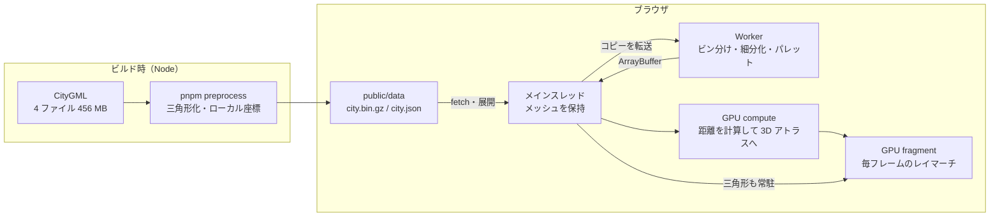
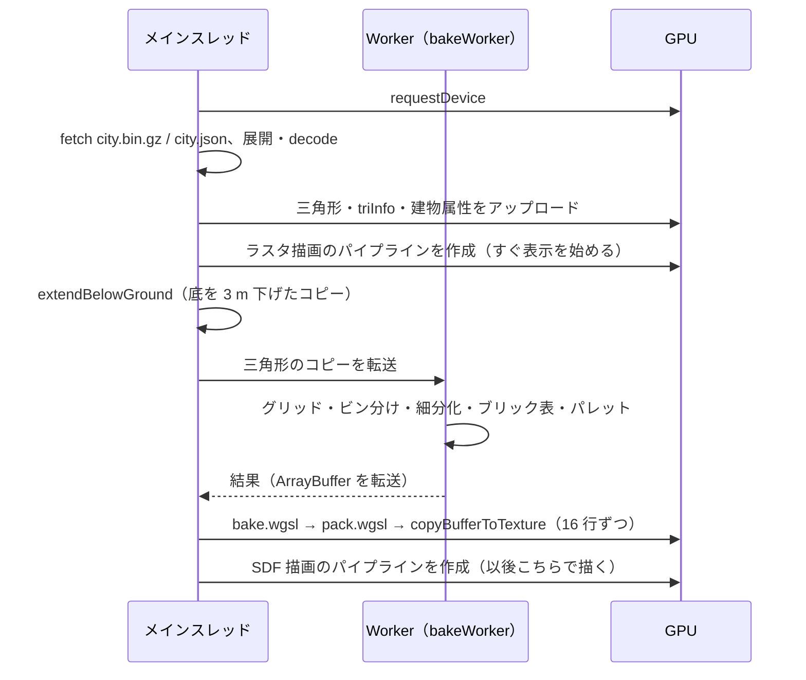
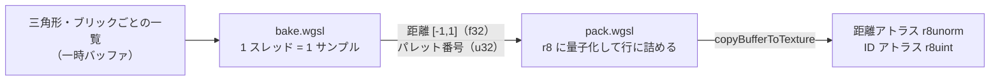
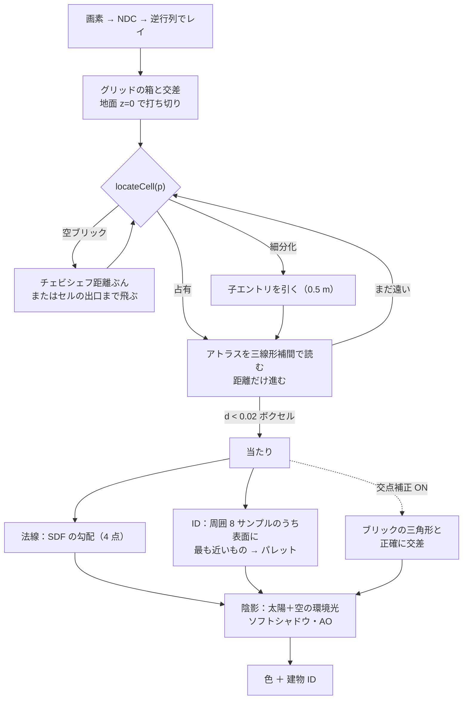

# 東京駅ページ（`/`、LOD2）の仕組み

東京駅周辺の建物（LOD2。LOD2 の無い建物は LOD1）を、1 回だけ疎なブリック SDF に焼き込んでレイマーチで描きます。地域ページ（LOD1）との違いは [lod1-areas.md](lod1-areas.md) を参照してください。

| 項目 | 値 |
|---|---|
| 範囲 | 3 次メッシュ 53394610 / 611 / 620 / 621（約 2.3 km × 2.0 km） |
| 建物・三角形 | 2,548 棟、722,104 三角形 |
| ボクセル | 1 m（細かい部分は 0.5 m に細分化） |
| 配信データ | `city.bin.gz` 5.2 MB（展開後 29 MB）＋ `city.json` 0.6 MB |
| GPU | アトラス 424 MB（距離 r8 ＋ ID r8、28 万スロット） |



## 1. データの前処理（ビルド時、Node）

`pnpm preprocess`（`scripts/preprocess/main.ts`）が `data/raw/*.gml` を読み、`public/data/` に書き出します。入出力は `main.ts` だけが行い、変換はすべて単体テスト付きの純粋関数です。

1. **建物ごとに分割**（`gml.ts` の `splitBuildings`）: 最大 250 MB の GML を行単位のストリームで読み、`<bldg:Building>` ごとの文字列にまとめます。ファイル全体を DOM にはしません。
2. **形状の抽出**（`buildMesh.ts`）
   - LOD2 があれば、`bldg:boundedBy` の各面（屋根・壁・底面など）と `lod2Geometry`（付属物）の多角形を使います。面の種類をそのまま `SurfaceType` にします。
   - LOD2 が無い建物は `lod1Solid` を使い、面の種類は法線から推定します（上向き = 屋根、下向き = 底面、それ以外 = 壁）。
3. **座標変換**
   - 緯度経度を、東京駅（139.767125, 35.681236）を原点とするローカル座標に変換します（`src/geo/localFrame.ts`）。x = 東、y = 北で、水平方向はメルカトル尺度のメートルです。MapLibre のメルカトル座標とは 1 つのアフィン変換で対応します。
   - 建物ごとに、底面（無ければ全頂点）の最も低い点を地盤高とみなして z から引きます。どの建物も z = 0 に立ちます。
4. **三角形分割**（`src/geom/polygon.ts`）: 多角形を面の法線で 2 次元に投影し、earcut で穴付きのまま三角形にします。面積 1e-4 m² 未満の三角形は捨てます。
5. **重複の除去と結合**（`assemble.ts`）: 複数のメッシュファイルに出てくる同じ `gml:id` は最初の 1 つだけ残し、全建物を 1 つのメッシュにまとめます。
6. **属性**: 名称・用途・計測高さ・階数・建築年・所在地・建物 ID を取り出し、PLATEAU で「不明」を表す ±9999 を除きます。

## 2. データの配信

### `city.bin.gz`（`src/data/meshFormat.ts`）

```
header         u32 × 16   magic 'SDFP', version, triCount, buildingCount, boundsMin/Max (f32)
positions      f32 × triCount × 9      三角形の頂点（ローカル座標 m、外向き CCW）
triInfo        u32 × triCount          buildingIndex << 3 | surfaceType
buildingRanges u32 × buildingCount × 2 建物ごとの (先頭の三角形, 三角形数)
```

- 29 MB を gzip で 5.2 MB にしています。Cloudflare の静的アセットは 1 ファイル 25 MiB までのためです。
- ブラウザは `DecompressionStream` で展開します（`src/data/gzip.ts`）。サーバが `Content-Encoding: gzip` を付けて配信し、ブラウザがすでに展開している場合は、先頭の gzip マジックバイトで判定してそのまま使います。

### `city.json`（`src/data/buildings.ts` の `CityMeta`）

原点、使ったメッシュ、建物ごとの属性（`triInfo` の buildingIndex と同じ並び）を入れています。

どちらも Astro の静的ビルドで `dist/data/` にコピーされ、Cloudflare Workers の静的アセットとして配信されます。サーバ側の処理はありません。

## 3. 描画前の処理

`src/app/app.ts` の `startApp` が順に行います。



### 3.1 底の延長（`src/bake/extendBase.ts`）

レイマーチは地面 z = 0 で止まるので、建物の底面がちょうど z = 0 にあると、三線形補間で丸まった壁の裾が地面との間にギザギザの隙間を作ります。焼き込み用のコピーでは z ≤ 0.05 の頂点を 3 m 下げ、壁が地面を突き抜けて続くようにします。描画用の三角形（ラスタ描画・交点補正）は元のままです。

### 3.2 CPU 側（Worker、`src/bake/prepare.ts`）

1. **グリッド**（`gridSpec.ts`）: ボクセル 1 m、ブリック 8 m（8³ セル、サンプルは角を共有して 9³）。範囲は三角形の外接箱に 2 ボクセルの余白を足し、下端は地面より下まで含めます。
2. **ビン分け**（`binning.ts`）: 三角形ごとに、重なるブリックを三角形と箱の分離軸判定（`src/geom/triBox.ts`）で求めます。
   - 表面から 1 ボクセル以内にあるブリックを「占有」とし、アトラスのスロットを割り当てます。
   - 占有ブリックには、打ち切り幅（4 ボクセル = 4 m）以内の三角形の一覧を持たせます。そのブリックのサンプルの距離は、この一覧だけで正確に求まります。
3. **細分化**（`refine.ts`）: 一覧の三角形が 16 個以上ある「細かい」ブリックを、多い順に 2³ 個の子ブリック（0.5 m ボクセル）に置き換えます。スロットの合計が 28 万に達したら止めます。子も同じ 9³ のレイアウトでアトラスを共有し、占有している子だけがスロットを持ちます。実データでは 25,230 個が細分化されます。
4. **ブリック表**（`indirection.ts`, `refine.ts`）: グリッドの全ブリックに u32 を 1 つずつ持たせます。
   - 占有: アトラスのスロット番号
   - 空: `EMPTY_FLAG | 最寄りの占有ブリックまでのチェビシェフ距離`（3 次元の距離変換、`distanceTransform.ts`）
   - 細分化: `REFINED_FLAG | 子エントリの先頭位置`（子エントリは同じ表の後ろに追加）
5. **パレット**（`palette.ts`）: スロットごとに、一覧に出てくる `triInfo`（建物番号と面の種類）を最大 256 種類まで並べます。ベイクはサンプルごとに「最近接三角形のパレット番号」を 1 バイトで記録します。

### 3.3 GPU 側のベイク（`src/bake/bakeGpu.ts`）



- **`bake.wgsl`**: 各サンプル点について、そのスロットの一覧の三角形への最短距離を `closestPointTriangle` で求めます。
  - 符号は最近接三角形の面の法線で決めます。ほぼ同じ距離の三角形が複数ある場合（辺や角の近く）は、面がサンプル点の方向を最もよく向いているものを選びます。
  - 距離は打ち切り幅で割って [-1, 1] にします（細分化した子は子のボクセルに比例した打ち切り幅）。
- **`pack.wgsl`**: 距離を `d / 2T + 0.5` で 0〜255 に量子化し（`sdfCodec.wgsl`）、4 テクセルずつ u32 に詰めます。行は `copyBufferToTexture` の 256 バイト境界に揃えます。
- **アトラスの並び**（`atlasLayout.ts`）: x 方向に 128 スロットを固定で並べ（128 × 9 = 1,152 テクセル）、y・z 方向に積みます。各辺は 2,048 テクセル以下に収めます。
- 処理は 16 スロット行ずつに分けて投入し、進み具合をステータスに出します。終わったら一時バッファを破棄します。

## 4. レンダリングパイプライン

描画は 2 系統あり、パネルの「描画」で切り替えられます。どちらも色と建物 ID（r32uint、クリックでの建物選択用）の 2 つを出力します。

### 4.1 毎フレームの準備（CPU、`src/app/viewer.ts`）

1. MapLibre の custom layer の `render()` から、メルカトル → クリップ行列を受け取ります（WebGL の描画は何もしない空のレイヤ）。
2. ローカル → メルカトル行列を float64 で掛け、ローカル → クリップ行列とその逆行列を作ります。原点から数 km 離れても精度が落ちないよう、合成は CPU の float64 で行います。
3. 太陽の方向と強さを日時と緯度経度から計算し（`src/geo/sun.ts`）、行列・表示モード・フラグと一緒にフレーム用 uniform（176 バイト）へ書き込みます。
4. WebGPU のキャンバス（MapLibre のキャンバスの上に重ねた透明なキャンバス）に描きます。

### 4.2 SDF レイマーチ（`sdfRender.wgsl` ＋ `sdfScene.wgsl`）

頂点バッファは使わず、`draw(3)` で画面を覆う三角形を 1 枚描き、フラグメントシェーダが画素ごとにレイを飛ばします。



- **セルの特定**（`locateCell`）: 位置 → ブリック座標 → ブリック表を引きます。細分化ブリックなら子エントリをもう 1 段引きます。
- **空ブリックの読み飛ばし**: チェビシェフ距離 k の空ブリックからは、少なくとも (k − 1) ブリックぶん表面がないので一気に進めます。k が 1 ならセルの出口まで進みます。
- **スフィアトレース**: 占有ブリックではアトラスを `textureSampleLevel` の三線形補間で読み、その距離だけ進みます。距離が 0.02 ボクセル（＋遠方ほど少し大きく）を下回ったら当たりです。最大 256 歩です。
- **法線**: 4 点の四面体配置で SDF の勾配を取ります。
- **建物と面の種類**: ID アトラスの周囲 8 サンプルのうち、距離が 0 に近く当たった点にも近いサンプルのパレット番号を使い、`slotPalettes` から `triInfo` を引きます。屋根・壁・底面の境界は ID の格子では粗いので、面の種類は法線から決め直します（付属物などは ID のまま）。
- **交点補正**（パネルの「交点を三角形で補正」）: 当たった点から 1.5 ボクセル戻り、そのブリックの三角形の一覧とレイの交差を正確に求めます（`intersectSlot`）。当たれば位置・法線・`triInfo` を三角形から取ります。r8 の量子化と補間で丸まった角が、元の形どおりに戻ります。
- **陰影**（`shading.wgsl`）
  - 太陽の直射光と、法線の向きで色を変える空の環境光を足します（線形空間で計算）。
  - ソフトシャドウ: 太陽方向に最大 96 歩、SDF の距離で進みます。打ち切り幅の内側で得た正確な距離だけを使い、「距離 ÷ 進んだ距離」の最小値を半影の濃さにします。
  - AO: 法線方向に 5 点、1.2 m 間隔で距離を読み、期待より近ければ暗くします。
- **地面**: 建物に当たらなかったレイは z = 0 の点から影と AO だけを計算し、暗さを半透明の黒として出します。地図の上に影だけが落ちます。
- **色分け**: 面の種類・高さ・用途・建築年は建物属性バッファ（vec4 / 棟: 高さ、用途の分類、建築年、LOD）から決めます。「ステップ数」はレイの歩数を色にするデバッグ表示です。

### 4.3 ラスタ描画（比較用、`raster.wgsl`）

- 頂点バッファを使わず、`draw(3 × 三角形数)` の頂点番号から `sceneTris` を直接読みます。深度テストあり、面の法線は flat です。
- 影と AO はありません（可視性 1 で同じ `shadeSurface` を使う）。
- SDF 描画が正しいかを確かめる基準として使います。`src/render/renderDiff.test.ts` で、同じカメラからの建物 ID の画像を、SDF の結果と画素単位で比較しています。

### 4.4 建物の選択

クリックした画素の ID ターゲットを 1 テクセルだけ読み戻し（`readIdAt`）、建物番号 + 1 から `city.json` の属性を引いてポップアップを出します。選択中の建物は、両方のパイプラインで黄色く混ぜて描きます。
